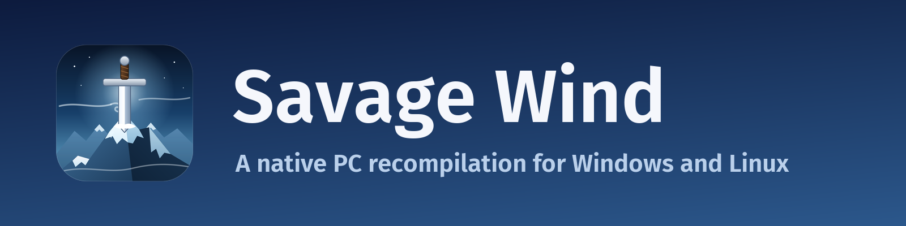

  <a href="https://github.com/Revivedx/SavageWindRecomp/releases/latest"><b>Download</b></a> ·
  <a href="#get-started">Get started</a> ·
  <a href="docs/STATUS.md">Status</a> ·
  <a href="docs/FAQ.md">FAQ</a> ·
  <a href="https://github.com/Revivedx/SavageWindRecomp/issues">Issues</a> ·
  <a href="CHANGELOG.md">Changelog</a>

**Savage Wind Recomp** is a work-in-progress static recompilation of *The Legend of Zelda: Breath of the Wild*
(Nintendo Switch, version 1.9.0) into a native application for Windows and Linux, built from your own copy of the
game.

  
  
  
  

Screenshots taken in Savage Wind. The game is © Nintendo; you need your own copy to run it.

> [!IMPORTANT]
> **No game files are included.** You need your own legally obtained copy of the game, updated to **version 1.9.0**
> and dumped from **your own** Nintendo Switch. This project does not provide game files, keys, firmware, dumping or
> decryption tools, or instructions on how to obtain them. The game code is recompiled locally, on your machine,
> from your files.

> [!NOTE]
> **Made almost entirely with AI.** Nearly all of the code, tooling, reverse engineering and documentation is written
> by an AI (Anthropic's Claude, through Claude Code), directed, tested and reviewed by a human. It builds on
> [LAS Recomp](https://github.com/peiikai/LASRecomp), made the same way. If you don't trust code written by AI, you
> can simply ignore this project.

> [!WARNING]
> **This is an alpha.** The whole game can be finished from start to end, but expect bugs and crashes in some places,
> and some mechanics that break above 30 fps ([#425](https://github.com/Revivedx/SavageWindRecomp/issues/425)). If a
> cutscene freezes or breaks, lower the frame rate to 30 fps for that scene.

## Features

- The whole game and both DLC, from your own copy
- Frame rates from 30 to 360 fps, or your display's own rate
- Resolutions up to 4K and beyond, ultrawide, and FSR 1 upscaling
- Graphics presets from Potato, below console quality, to Savage, far beyond it
- Longer draw distance, sharper shadows, adjustable field of view, colour grading and HDR
- Keyboard and mouse with real mouse camera, and any controller, gyro included
- Button prompts that match your device
- Save profiles, backups, and Wii U / Cemu save import
- Steam Deck and PC handhelds
- Photo mode, accessibility options and cheats

## Get started

**You need:** your own game files (see [Game files](docs/game-files.md)), Windows 10 or later or Linux on x86-64, a
GPU with Vulkan 1.3, 16 GB of RAM, a CPU with SSE4.2 (AVX2 runs faster) and about 20 GB of free disk space.

1. Download the latest build from [Releases](https://github.com/Revivedx/SavageWindRecomp/releases/latest):
   - **Windows:** the file ending in `windows.zip`. Extract it to a folder you can write to, not Program Files.
   - **Linux and Steam Deck:** the file ending in `x86_64.AppImage`. Make it executable and run it
     ([docs/linux.md](docs/linux.md)).
   - **Linux on ARM:** the file ending in `aarch64.AppImage`. It is highly experimental.
2. Start it and choose the folder with your extracted game (`exefs/` and `romfs/`). Then choose **Set up game files**.
   It checks the version, copies the files and recompiles the game code once, about 15 minutes on a 12-thread CPU.
   Your own files aren't changed.
3. Play. Settings and languages are in the game's Options. **Savage Wind Configuration** has your game files and the
   rest of the settings.

**Updating:** from version 0.5.1 on, Savage Wind Configuration updates it in one click, on Windows and in the Linux
AppImages. Before that, extract the new zip over the old folder or use the new AppImage. Your game files, saves and
settings stay.

Something wrong? See the [FAQ](docs/FAQ.md), which also lists the known issues.

## Saves

Saves are in the `save` folder of Savage Wind's data folder: next to `savagewind.exe` on Windows, and in
`~/.local/share/savagewind/save/` on Linux and the Steam Deck. To back them up or move them, close the game and copy
the whole folder. More in [Saves](docs/saves.md), including profiles and Wii U / Cemu import.

## Status

| Area | Share | Progress |
|---|---|---|
| Core game | 45% |  |
| Platforms and input | 15% |  |
| Performance | 15% |  |
| Graphics options | 12% |  |
| Player features | 13% |  |

Every part, what it means and how the average is calculated: [Status](docs/STATUS.md).

## Controls

Any controller SDL knows works. Keyboard and mouse defaults:

| Action | Key | Action | Key |
|---|---|---|---|
| Move | W A S D | Camera | Mouse |
| Jump | Space | Sprint / back | Left Shift |
| Interact | E | Attack | Left click |
| Shield | Right click | Bow | F |
| Rune | Q | Throw | R |
| Inventory | Tab | Map | M |

Every action can be rebound in the game's Options. All the keys: [Controls](docs/controls.md).

## Found a bug?

Read the [FAQ](docs/FAQ.md) first: issues about something it already covers are closed right away. Use the latest
release and game version 1.9.0, search the [existing issues](https://github.com/Revivedx/SavageWindRecomp/issues?q=is%3Aissue),
and [open one](https://github.com/Revivedx/SavageWindRecomp/issues/new/choose) with your `savagewind.log`. On a crash
or a cutscene bug, attach your zipped `save` folder too. Reports without these are closed after 7 days.

## Contributing and building

Open pull requests against the [`test`](https://github.com/Revivedx/SavageWindRecomp/tree/test) branch, which has
everything ahead of the latest release. See [CONTRIBUTING.md](CONTRIBUTING.md). To build from source:
[Windows](docs/BUILD-windows.md) and [Linux](docs/linux.md).

## Respect copyright

- *The Legend of Zelda: Breath of the Wild* is © Nintendo. This is a fan project. It is not affiliated with,
  endorsed by or sponsored by Nintendo. *Nintendo Switch* and *The Legend of Zelda* are trademarks of Nintendo.
- This repository contains no game files, no game code (also not the C code the recompiler generates from it), no
  assets, no fonts, no keys - and release builds won't either.
- The game code you generate and the build made from it contain Nintendo's code. They are for your own use only:
  don't share them, upload them or ship them.
- Issues, pull requests or discussions that contain game files, keys, generated code or links to pirated copies
  will be removed. Piracy is not supported in any way.
- Follow the copyright laws of your country. Dumping a game you own for personal use is legal in some countries and
  not in others; that is your responsibility.

## Credits and license

Built on **[LAS Recomp](https://github.com/peiikai/LASRecomp)** by peiikai (MIT), with
[TotK Recomp](https://github.com/valentderah/totk-pc-recomp) by Valiantsin Dzerakh (MIT) and
[Ryujinx](https://github.com/Ryujinx/Ryujinx) (MIT) as references. Full list and the licenses of what releases bundle:
[Credits](docs/third-party.md).

Savage Wind Recomp's own code is under the [MIT License](LICENSE). The license covers this project's code only: it
grants nothing for Nintendo's game, which you must supply yourself.
